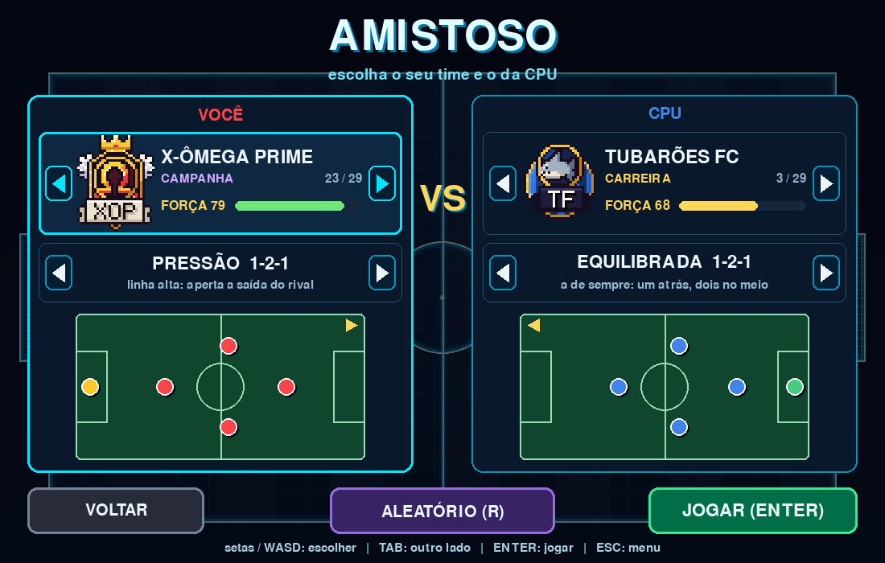
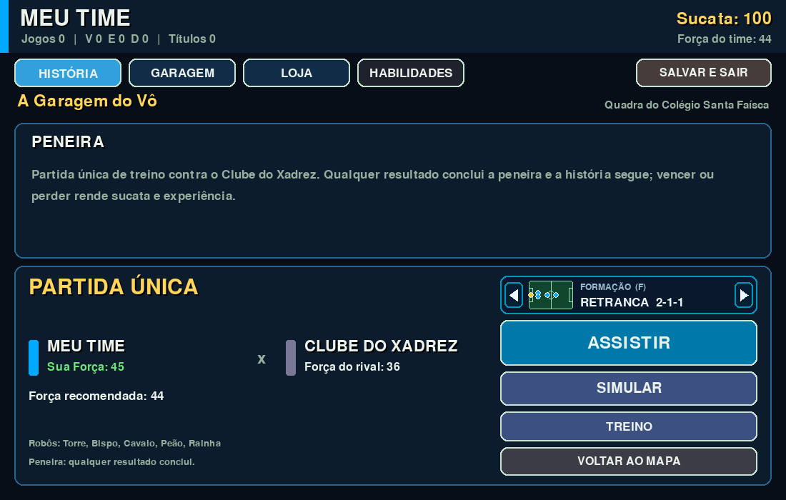
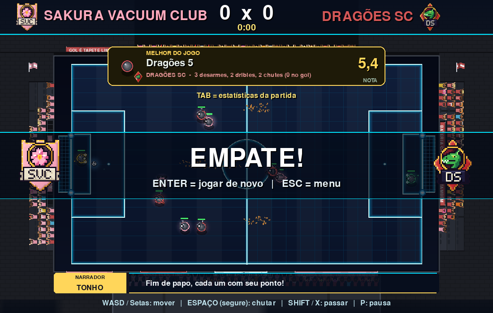
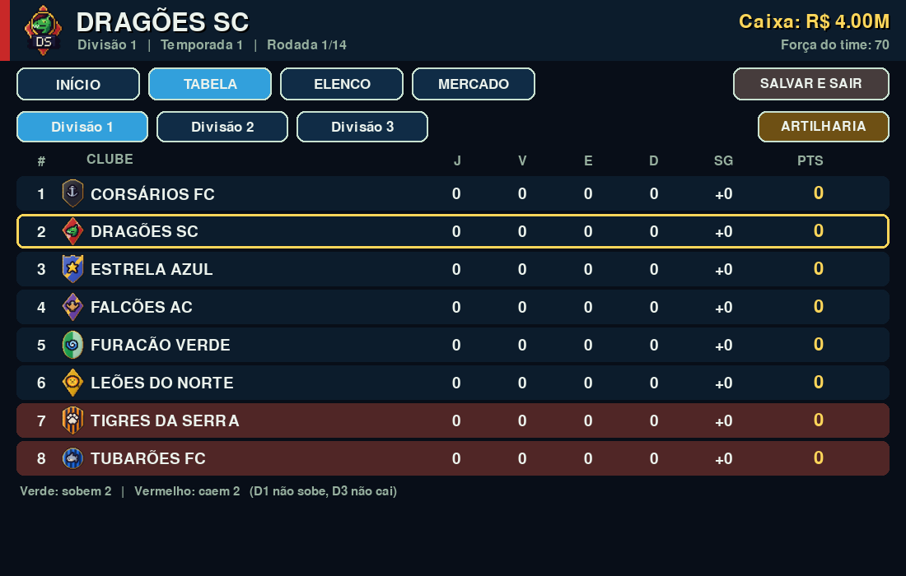
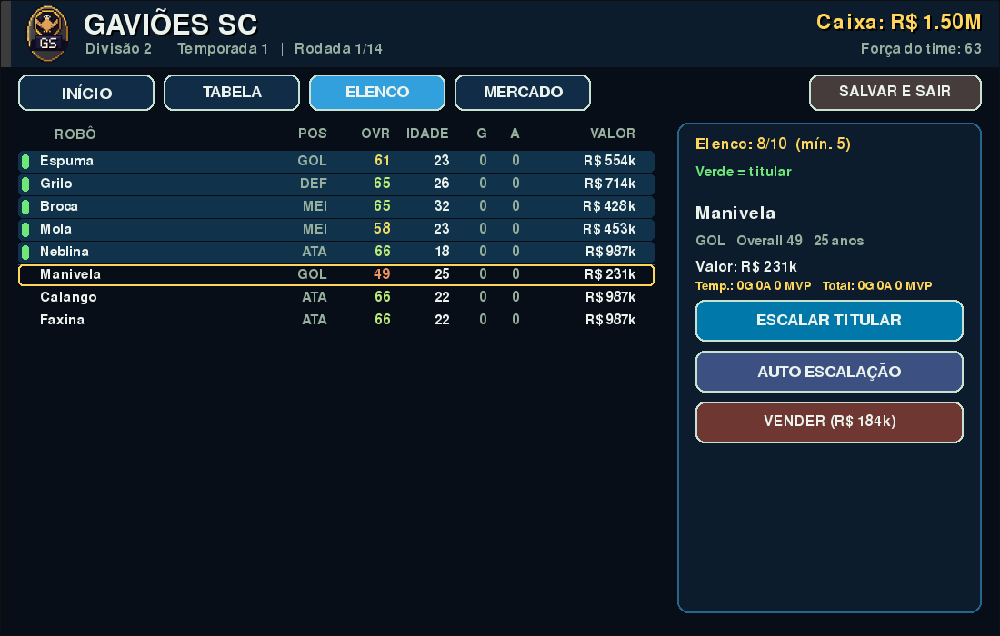
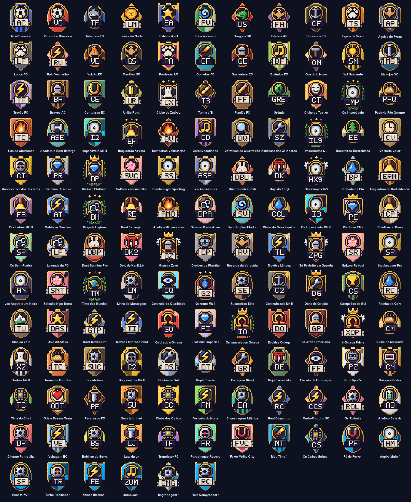
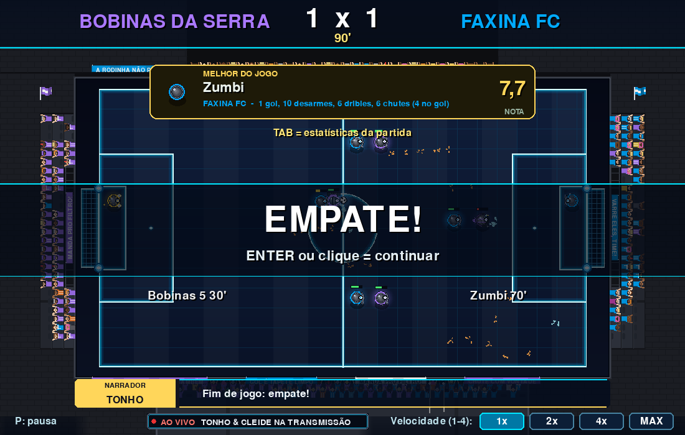
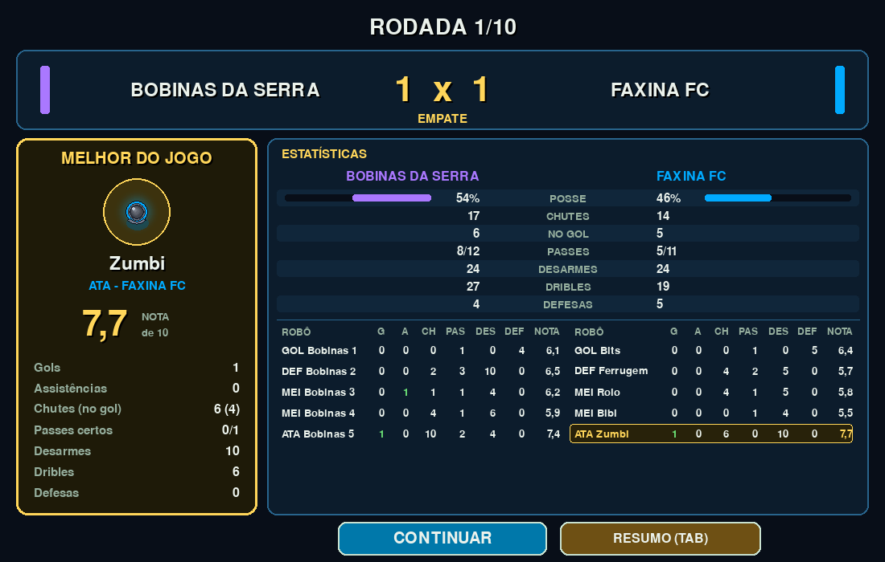
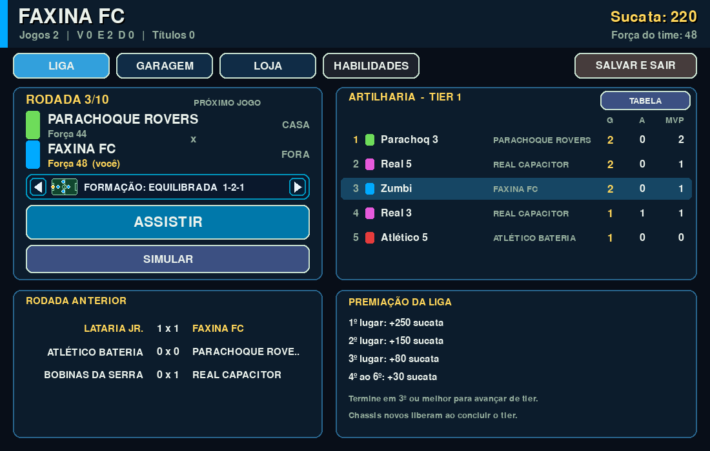

# SoccerRobo (Copa Aspirador)


[](https://copaaspirador.brunokobi.tech)

**Jogue agora no navegador: https://copaaspirador.brunokobi.tech**

Futebol arcade 5x5 feito **100% em Python** (pygame), que roda no navegador via
[pygbag](https://pygame-web.github.io/) (Python -> WebAssembly). O projeto está
virando um **futebol de robôs aspiradores** com campanha em estilo RPG
(escola -> mundial), laboratório de upgrades e partidas automáticas decididas
pelas habilidades dos robôs.

## Telas

| | |
|---|---|
|  |  |
| **Menu** - amistosos, carreira de clubes, Modo Robôs e campanha | **Partida** - câmera de estádio, torcida reagindo ao gol, LED e faixa do narrador |
|  |  |
| **Campanha** - diálogos com personagens e cenários em pixel art animados (torcida com rostos, piso de tábuas, luzes) | **Mapa da campanha** - da escola ao Mundial de Aspiradores, com o escudo do chefe de cada capítulo |
|  |  |
| **Torneio** - grupo, chaveamento, final contra o chefe (escudos em todas as tabelas), formação e ASSISTIR ou SIMULAR | **Modo Robôs** - liga de 6 times em 4 tiers, com escudos e a formação do próximo jogo |
|  |  |
| **Garagem** - 8 slots (com Módulo), sets, relíquias e o antes/depois de cada peça | **Habilidades** - árvore Ataque/Controle/Defesa, skills equipadas e tática do time |
|  |  |
| **Mochila** - até 2 itens de partida, gastos ao jogar | **Visual** - adesivo, antena, rastro e comemoração por robô |

|  |  |
|---|---|
| **Amistoso** - antes da partida, o time e a formação de cada lado (escudo em pixel art, força e mini-campo com a posição dos robôs) | **Formação** - o mesmo seletor na campanha, no Modo Robôs e na carreira |

|  |  |
|---|---|
| **Ato 2** - mapa por Ato (Ato 1 escola ao Mundial, Ato 2 Superliga Limpex, Ato 3 Copa dos Campeões) | **Superliga** - liga em pontos corridos, os 4 primeiros vão à semifinal |


**Missões secundárias** - 14 missões avulsas com prêmio próprio; as 4 "Fitas do Vô" levam ao final secreto.

|  |  |
|---|---|
| **Fim da partida** - escudos dos dois times no placar e na faixa do resultado | **Carreira** - escudo de cada clube na tabela, no próximo jogo e nos resultados |



**Elenco da carreira** - robôs aspiradores com nome de robô, de 5 a 10 por time (5 titulares em verde).



**Escudos** - os 128 times do jogo (e exemplos de nomes do time do jogador, com *), desenhados por código.

**Pós-campanha (Onda D):**

| | |
|---|---|
|  |  |
| **Fim da campanha** - galeria de finais e as portas do pós-jogo: Turnê Lendária (NG+) e Torre do Pó | **Torre do Pó** - 40 andares, modificador de arena a cada 5 e prêmios nos marcos 10/20/30/40 |
|  |  |
| **Modificador de arena** - goleiro gigante (também bateria curta e bola pesada) | **Peça Mítica** - raridade acima da Lendária, só como prêmio do NG+ e da Torre |

Robôs em campo com cosméticos (câmera PERTO):


## Visual
Tema tecnológico/neon: arena com grade e linhas holográficas, robôs-disco com
anel de LED e barra de bateria, bola com brilho, rastro e faíscas, e HUD e menu
novos.

**Escudos dos times:** todos os 128 times do jogo (amistoso, carreira, campanha e liga do Modo Robôs;
os adversários da Torre e do treino usam o escudo do time da liga de mesmo nome) têm um escudo em pixel
art desenhado por código (`game/crests.py`), sem nenhuma imagem externa: formato (clássico, redondo,
losango, hexágono, pontudo, francês, oval), padrão nas cores do time (liso, faixa, listras, metade,
diagonal, quartos, chevron, aro), medalhão com um símbolo 15x15 escolhido pelo nome (tubarão, leão,
dragão, raio, chama, coroa, flor de cerejeira, torre de xadrez, aspirador-robô, engrenagem, pão, vassoura,
furacão, cavaleiro, trevo, ômega e mais ~40) e faixa com as iniciais. O mesmo time gera sempre o mesmo
escudo. Os chefes e rivais da campanha (Os Impecáveis, Guarda Zero, X-Ômega Prime e o chefe de cada
capítulo) têm escudo especial com coroa ou estrelas e louros ou asas. Aparecem no amistoso, no placar e
no fim da partida, nas ESTATÍSTICAS/MELHOR DO JOGO, nas tabelas, artilharia, chaveamento, cards de
resultado, carreira, mapa da campanha e Torre. O escudo do seu time sai do nome e da cor; no Modo Robôs e
na campanha, **clique no escudo do topo** para trocar o símbolo (**SHIFT + clique** troca o formato).

**Pisos do campo:** cada partida sorteia um piso, sem repetir o anterior. Pode ser a arena neon
original ou um piso de casa: cozinha em xadrez, tacos de madeira, porcelanato, ladrilho hidráulico ou
cimento queimado (afinal, são aspiradores jogando dentro de casa). Os pisos são desenhados por código
no início da partida (`game/floors.py`) e escurecidos para a bola e os robôs continuarem legíveis.

**Comemoração:** no gol, a tela dá um clarão, o "GOOOOL!" entra tremendo e pulsando e os fogos de
artifício estouram sobre o campo nas cores do time (`game/fireworks.py`); a vitória também solta fogos.

**Torcida:** arquibancadas ao redor do campo com espectadores nas cores dos times,
de uma quadra de escola ao Mundial lotado (o local muda com o capítulo e o modo; no
Modo Robôs, com o tier da liga: bairro, ginásio, arena e estádio). A torcida ocupa
primeiro as arquibancadas laterais, que a interface não cobre. Cada torcedor tem um visual sorteado:
6 tons de pele, 14 cabelos, chapéus e bonés, camisas lisas ou listradas, cachecóis e óculos escuros.
Nas pausas do jogo, uma torcida de cada vez puxa um **cântico**: todos pulam e agitam as bandeiras no
mesmo compasso, com palmas no áudio. A arquibancada tem **bandeiras e bandeirões** nas laterais e
**faixas penduradas na grade** (embaixo do campo; na câmera ESTÁDIO, também em cima), com frases da
torcida e do local.
Ela reage a gol, chance, defesa e trave (pula, levanta os braços, faz ola e
mosaico), com confete, flashes, sinalizadores, bandeiras e placas de LED. Tecla **T**
(no menu ou na pausa) alterna a torcida entre ALTA, MÉDIA e DESLIGADA; ela some
no modo MAX. **Câmera de estádio:** TODA partida (amistoso, carreira, Modo Robôs, campanha e demo)
começa na câmera ESTÁDIO: o campo reduzido (80%) com arquibancadas largas em volta, em cima, nas
laterais e embaixo. Na pausa, **C** troca para PERTO (campo em tela cheia) só naquela partida; a
seguinte volta ao ESTÁDIO. O jogo nunca troca a câmera sozinho (nem no gol): se o quadro pesar, quem
diminui são a torcida e os fogos. Com a torcida DESLIGADA não há estádio (campo cheio). **F11** abre a
tela cheia.

**Narração:** o narrador **Tonho** e a comentarista **Cleide** falam numa faixa de TV (tarja com o
nome de quem fala) lance a lance: saída, chute, defesa, trave, gol (empate, virada, gol contra),
desarme, drible, skill, placar e fim de jogo, com os nomes reais dos times e dos robôs (no amistoso os
robôs ganham apelidos), e puxam assunto na calmaria (estatística, piada, patrocinador). Uma fala por
vez, com fila e prioridade (gol corta o resto, lance pequeno só com a faixa livre). Na câmera ESTÁDIO a
faixa fica sob o campo; na PERTO, dentro do campo, sempre do lado oposto ao da bola
(`game/narration.py`). No lugar dos antigos letreiros da torcida ("GOOOL!", "UHHH!"...).

## Som
Efeitos sintetizados por código (`game/sfx.py` e `game/music.py`, gerados com `math`/`array` no
início do jogo, aos poucos) somados a sons gravados em `game/audio/` (OGG mono, volume nivelado por
`tools/normalizar_audio.sh`, ~7,3 MB no total):

- **Músicas (stream, uma faixa depois da outra, em loop):** menu principal = `menu1/2/3.ogg` (`menu1` = "Era do Metal", a primeira a tocar)
  (desde o clique da tela de carregamento); tela de robôs = `interno1/2.ogg` + `submenus.ogg`;
  carreira e campanha = `copas.ogg` + `interno1/2.ogg`; **partidas** (amistoso, carreira, Modo Robôs e
  campanha) = `partida_musica.ogg` ("Into the Iron Horizon", 3 min, em loop), mais baixa que a torcida e
  os efeitos.
- **Torcida de fundo da partida:** toca junto com a música, num canal próprio: `torcida_loop.ogg`, 24 s
  em loop sem emenda audível, feito por `tools/torcida_loop.sh` com as 3 gravações de torcida
  misturadas (crossfade entre o fim e o começo). Segue o volume dos efeitos (**S**); a música segue o
  **N**; **M** corta as duas.
- **Reações da torcida (tabela única `FILE_SFX` em `game/sfx.py`):** cada reação tem de 3 a 9
  variações (gravações + variações derivadas delas em tempo de execução: outro tom/andamento ou outro
  trecho, sem arquivo novo), sorteadas em "saco embaralhado" (toca todas antes de repetir, nunca a
  mesma duas vezes seguidas). Grito de gol do jogador (9), do adversário (7, com um "não!"), lamento da
  torcida no gol sofrido (4; gol contra do nosso time: vaia), "uuuh" da chance (6), quase gol (6 / 3), defesa (4),
  trave (4, junto do CLANG), olé no drible e na defesa do jogador (4), palmas (3-4), vaia (3),
  início "começou!" (3), festa da vitória (3) e lamento da derrota (3). Vozes faladas têm intervalo
  próprio maior para não cansar. Detalhes em [docs/specs/som.md](docs/specs/som.md).
- **Outros efeitos gravados:** apito final com o "acabou!", robôs desligando no fim, caixa registradora
  no card do resumo da partida (qualquer placar), palmas nos cânticos e na ola da torcida e o clique dos
  menus.
- **Motor dos robôs:** `robo_motor.ogg` em loop, baixo, enquanto a bola rola (para na pausa e no MAX).
- Se algum arquivo faltar ou não abrir, entra o som sintetizado equivalente.

Ligados por padrão em volume médio.

- **Efeitos:** chute e toque na bola, roubo e drible, trave (CLANG), apito de início e de fim, gol
  (explosão da torcida + buzina), "uuuh" da chance, defesa, palmas, skill (BUZZ), arrancada (ZOOM),
  cliques de menu, avanço de diálogo, recompensa, compra e upgrade na loja.
- **Música** chiptune em loop (só se faltarem os arquivos): uma trilha para menus/campanha e outra, mais
  animada e mais baixa, para a partida.
- **Teclas:** **M** liga/desliga o mudo geral (em qualquer tela); **S** gira o volume dos efeitos e
  **N** o da música (DESL. / BAIXO / MÉDIO / ALTO), no menu ou na pausa. Tudo fica gravado nas
  preferências. No modo MAX a partida fica sem efeitos.
- No navegador o áudio só começa depois do primeiro clique (a página já pede esse clique); se o
  áudio falhar, o jogo segue sem som. Detalhes em [docs/specs/som.md](docs/specs/som.md).

**Robôs e cenas:** cada chassi tem desenho próprio (o Orbital com satélites, o
Titã octogonal), as peças equipadas aparecem no robô (turbina, canhão, para-choque
blindado, radar...), as escovas giram e a bateria baixa solta faíscas e fumaça.
Na campanha, personagens e cenários são **pixel art** desenhada por código (`game/portraits_pixel.py`,
`game/scenes_pixel.py`): os personagens piscam e mexem a boca ao falar, com expressão por humor, e os
cenários têm torcida, luz e animação.

## Modos
No menu (teclas 1-6): `1 - AMISTOSO`, `2 - AMISTOSO`, `3 - NOVA CARREIRA`, `4 - CONTINUAR CARREIRA`, `5 - MODO ROBÔS` e `6 - CAMPANHA`.

**Modo demo:** com o menu principal parado por 1 minuto, começa uma demonstração (amistoso CPU x CPU com
torcida, ~1 min) sem trocar a música do menu. Qualquer tecla, clique, toque ou movimento do mouse volta ao menu.

1. **Amistoso: um jogador** contra a CPU (2 min)
2. **Amistoso: dois jogadores** no mesmo teclado

   Antes do amistoso, uma tela escolhe o **time** e a **formação** de cada lado. São 29 times que já
   existem no jogo: os 2 clássicos do amistoso (Azul e Vermelho, o padrão), 8 clubes da carreira, 13
   times da campanha (do Clube do Xadrez ao X-Ômega Prime) e 6 da liga do Modo Robôs, cada um com
   escudo, cor e força (os robôs entram em campo com a força do time). O mesmo time não pode estar dos
   dois lados; cores parecidas fazem o lado da direita trocar de cor, como nas outras partidas.
   Formações (mini-campo com a posição dos 5 robôs): **EQUILIBRADA 1-2-1** (a de sempre), **RETRANCA
   2-1-1** (dois zagueiros fechando o meio), **OFENSIVA 1-1-2** (dois atacantes abertos), **QUADRADO 2-2**
   e **PRESSÃO 1-2-1** (linha alta). A formação muda onde cada robô fica e para onde volta durante o jogo
   (posição base + avanço/recuo do bloco); os papéis e atributos dos robôs não mudam. A mesma escolha
   de formação existe na carreira, no Modo Robôs e na campanha (ver **Formação** abaixo).
   Teclas: setas/WASD escolhem (no modo 1 você escolhe os dois lados; TAB troca de lado; no modo 2 o J1
   usa WASD no lado esquerdo e o J2 as setas no direito, ao mesmo tempo), **R** = aleatório, **ENTER** =
   jogar, **ESC** = menu; com o mouse: setas < >, roda sobre a linha e os botões. A última escolha fica
   lembrada (na sessão e nas preferências); no fim da partida, ENTER joga a revanche com os mesmos times.
3. **Nova carreira de clubes** (estilo Elifoot): você é o técnico. 24 clubes fictícios
   em 3 divisões de 8 times (ida e volta, 14 rodadas). Os jogadores são **robôs aspiradores**
   com nome de robô ("Zumbido", "Faísca", "Rodinha", "Turbo Mk2", "Vassoura-7", "RX-07"...;
   catálogo de ~4,7 mil nomes em `game/robot_names.py`, tirado do id do robô, sem repetir no clube).
   **Elenco de 5 a 10 robôs** (5 titulares em campo: GOL, DEF, 2 MEI, ATA, e até 5 reservas; os
   clubes da CPU começam com 7-10, sempre com goleiro reserva) com overall/idade/valor,
   **mercado de transferências** (não compra acima de 10 nem vende abaixo de 5), finanças (bilheteria,
   salários, premiação), **promoção/rebaixamento** (sobem/descem 2) e evolução
   dos robôs entre temporadas. Save antigo (nomes de pessoa, 12-20 jogadores) é migrado ao
   continuar: todos ganham nome de robô e o elenco fica com os titulares + os melhores reservas até 10
   (no seu clube os excedentes são vendidos pelo valor de mercado e o dinheiro entra no caixa). Suas partidas são **jogadas automaticamente
   no campo** (você assiste; velocidade 1x/2x/4x/MAX nas teclas 1-4); as dos
   outros clubes são simuladas. Na aba INÍCIO, o seletor de **formação** do seu clube fica no
   painel da próxima partida. O progresso é salvo sozinho (`localStorage` no
   navegador; `~/.soccerpy_career.json` no desktop).
4. **Continuar carreira** (aparece quando há save)
5. **Modo Robôs**: você monta uma **equipe de robôs persistente** e disputa ligas.
   - **Equipe:** 5 titulares (GOL, DEF, 2 MEI, ATA) + reservas, até 8 robôs. Cada robô
     tem chassis, nome, cor, XP e nível (até 10).
   - **Chassis:** Disco (inicial), Tanque, Velocista, Goleiro, Orbital e Titã. Os quatro
     últimos são desbloqueados ao concluir ligas (Tanque, Velocista, Goleiro e,
     no último tier, Orbital e Titã).
   - **Peças:** 7 slots por robô (motor, bateria, para-choque, chutador, sucção, sensor,
     chip), em 4 raridades (Comum, Rara, Épica, Lendária). Cada peça pode ser
     melhorada de 0 a 5 com sucata. Os modelos "agressivos" (Turbina, Blindado,
     Canhão de Plasma etc.) dão mais bônus, mas gastam bateria.
   - **Overclock:** NORMAL, TURBO ou OVERDRIVE trocam desempenho por bateria.
   - **Progressão:** os robôs ganham XP nas partidas (os reservas ganham uma parte)
     e sobem de nível; as partidas rendem **sucata** e, às vezes, uma peça.
   - **Loja:** compra peças e modelos, vende as que sobram.
   - **Liga:** 6 times, ida e volta (10 rodadas), em 4 tiers de dificuldade. Em cada
     rodada você escolhe **assistir** (partida jogada no motor) ou **simular**
     (resultado estatístico). Terminar em 3º ou melhor libera o próximo tier, e a
     premiação em sucata depende da colocação. A **formação** do time é escolhida no painel do
     próximo jogo, na aba LIGA.
   - **Habilidades, itens e visual (Fase 4, Onda B)** - liberados ao concluir o tier 1 do
     Modo Robôs ou o Ato 1 da campanha (antes disso tudo joga exatamente como antes):
     - **8º slot "Módulo"**, 30 modelos de peça, 6 relíquias únicas e 5 sets (Faxineiro,
       Plasma, Titã, Dojo, Limpex) com bônus ao juntar 2, 3 e 4 peças do mesmo set.
     - **16 skills** (+11 especiais da campanha) que a IA usa sozinha durante a partida
       (Arrancada, Sucção Magnética, Chute em Curva, Muralha, Defesa Elástica, Choque
       Elétrico, Instinto Matador, Líder...): cada robô equipa até 3, aprendidas com
       pontos de habilidade (1 por nível) numa árvore Ataque/Controle/Defesa, com ranks
       1-3. Aba **HABILIDADES** na garagem e tática do time (Ofensivo / Equilibrado /
       Defensivo). Cada skill foi calibrada no próprio motor e soma Força ao time (até +9).
     - **Itens de partida** (Bateria Extra, Cera Turbo, Café do Prof., Fita Isolante, Pilha
       Reserva, Spray Anti-Poeira): comprados na LOJA, levados na **Mochila** (até 2 por
       partida) e gastos ao jogar.
     - **Cosméticos** (adesivo, antena, rastro e comemoração de gol): só visuais, comprados
       na aba COSMÉTICOS da loja e equipados por robô no botão **VISUAL** da bancada.
   - **Save próprio**, separado da carreira de clubes: `localStorage`
     (`soccerpy_robots_v1`) no navegador; `~/.soccerpy_robots.json` no desktop. Um save
     inválido só é sobrescrito pelo NOVO JOGO após confirmação explícita; a cópia fica em `.bad`.
6. **Campanha** "A Garagem do Vô": a história do torneio de robôs aspiradores, jogada
   sobre a mesma garagem/bancada/loja do Modo Robôs, mas com **save próprio**.
   - **Enredo:** Téo (Moreira) descobre na garagem do Vô Nestor o Zé Poeira, um
     aspirador antigo, e junta-se ao Prof. Ambrósio para salvar o clube de robótica do
     Colégio Santa Faísca. No caminho conhece Vivi (Valentina), Bia e Dudu, e passa a
     enfrentar a corporação Limpex e o chip X-9 do Dr. Augusto Brilhante, do torneio
     escolar ao mundial.
   - **Estrutura:** **Ato 1** "A Garagem do Vô": Prólogo + 5 capítulos (Copa Interclasses,
     Taça Vale do Pó, Estadual Limpex Cup, Copa Brasil e Mundial de Aspiradores) + epílogo.
     **Ato 2** "A Superliga Limpex", jogável inteiro: Capítulos 6 (Taça de Acesso), 7 (Superliga
     em pontos corridos), 8 (Playoffs) e 9 (O Clone, série de duelos contra o Zé Perfeito), com o
     Vô Nestor de volta, a Dra. Valquíria, o rival Gabi Trovão, a Dona Odete e o Mestre Ogawa, e três
     escolhas que mudam adversários, falas e recompensas. **Ato 3** "A Copa dos Campeões":
     Capítulos 10 (Intercâmbio), 11 (A Fábrica, que muda conforme o patrocínio), 12 (Copa dos
     Campeões) e 13 (O Chip Zero, contra o X-Ômega), com **3 finais** conforme as escolhas (um
     deles secreto). Mais **14 missões secundárias** no botão MISSÕES do mapa (as 4 "Fitas do Vô"
     levam ao final secreto). São ~160 cenas de diálogo. Retratos e
     cenários são **pixel art desenhada por código** (sem imagens externas). O mapa tem uma aba por Ato
     e um botão de **MISSÕES** secundárias.
   - **Escolhas:** algumas cenas oferecem 2-3 opções que mudam falas seguintes e podem dar
     recompensas (sucata, XP, peça). Esc na cena abre um mini-menu; PULAR CENA pede
     confirmação (e, se há escolha, assume a opção 1).
   - **Torneios:** grupo de 4 + mata-mata com pênaltis (o Mundial tem também quartas).
     Você é sempre o mandante. Em cada partida escolhe **ASSISTIR** (partida jogada no
     motor, velocidade 1x/2x/4x/MAX nas teclas 1-4) ou **SIMULAR** (resultado estatístico).
   - **Formação:** escolhida no painel da partida do torneio, no TREINO e na Torre do Pó.
   - **Chefes e "ajuda":** a cada derrota seguida contra o chefe ele perde 1 de Força
     (até -3); zera ao vencer.
   - **TREINO:** partidas ilimitadas contra um adversário mais fraco, na garagem ou no
     mapa, para juntar sucata e XP sem mexer no torneio.
   - **Progressão:** cada capítulo concluído dá recompensa única (sucata, peça, XP) e
     libera chassis (Tanque, Velocista, Goleiro e Titã nos Caps. 1 a 4) e recrutas
     (os robôs Gambiarra, Pixelado e Majestade). A loja evolui com o capítulo.
   - **Save próprio**, separado da carreira de clubes e do Modo Robôs: `localStorage`
     (`soccerpy_campaign_v1`) no navegador; `~/.soccerpy_campaign.json` no desktop. Um
     save inválido só é sobrescrito pelo NOVO JOGO após confirmação; a cópia fica em
     `.bad`. Um save com pequenos defeitos é reparado automaticamente, voltando ao início
     do capítulo. Desde a Onda C o save da campanha é **v2**: saves v1 são migrados ao
     carregar (quem já estava no epílogo ou tinha terminado vai para o Capítulo 6, sem
     refazer nada do Ato 1). Desde a Onda D o save é **v3** (NG+, Torre do Pó e peças
     Míticas): saves v2 são migrados ao carregar, sem rewind (quem terminou a campanha
     continua no fim, com o NG+ e a Torre liberados). Um build antigo (em cache no navegador)
     que abra um save mais novo o trata como inválido e o preserva em `.bad`, sem apagar.
   - **Pós-campanha (Onda D)**, liberado ao terminar o Capítulo 13 (qualquer final):
     - **Turnê Lendária (NG+)**: botão TURNÊ LENDÁRIA na tela de fim. Recomeça no Capítulo 1
       com a mesma garagem (robôs, peças, níveis, escolhas); os torneios viram revanches com uma
       cena curta por capítulo (sem repetir os diálogos) e os rivais ganham +20, +26 e +30 de Força
       nas voltas I, II e III (teto 90). Cada capítulo fechado dá sucata; o fim de cada Ato dá uma
       **peça Mítica** e cada volta concluída dá um cosmético exclusivo.
     - **Torre do Pó**: botão TORRE DO PÓ no mapa. 40 andares, uma partida por andar, rival de
       Força 54 + 0,9 por andar (55 a 90); a cada 5 andares a arena muda (**bola pesada**, **bateria
       curta** ou **goleiro gigante** do rival). ASSISTIR joga com o modificador; SIMULAR desconta da sua
       Força o efeito medido no motor. Empate vai aos pênaltis; perder só repete o andar. Os andares
       10, 20, 30 e 40 dão cosméticos (e 20 e 40, uma peça Mítica); no topo dá para recomeçar a subida.
     - **Peças Míticas**: uma raridade acima da Lendária (+2 de potência, cor rosa), só como prêmio
       do NG+ e da Torre (a loja e os drops nunca sorteiam). Sete cosméticos novos (antenas Para-raios,
       Coroa do Pó e Auréola; rastros Poeira Dourada e Cometa; comemorações Troféu e Relâmpagos) aparecem
       na loja como "prêmio" e não se compram.

### Formação (todos os modos)
Cinco formações: **EQUILIBRADA 1-2-1** (padrão), **RETRANCA 2-1-1**, **OFENSIVA 1-1-2**, **QUADRADO 2-2** e
**PRESSÃO 1-2-1**. Fora do amistoso, o seletor `FORMAÇÃO: < EQUILIBRADA 1-2-1 >` (com mini-campo) fica
acima do ASSISTIR: na campanha (torneio, treino e Torre do Pó), no Modo Robôs (aba LIGA) e na carreira
(aba INÍCIO). Clique nas setas ou no seletor, ou use as setas esquerda/direita, **F** (próxima) e
**Shift+F** (anterior). A escolha fica no save de cada modo (campo opcional `formation`; saves antigos
carregam com a EQUILIBRADA). Só o seu time muda: a CPU joga com a formação padrão. Medido no motor: com robôs
fracos as formações ficam perto da EQUILIBRADA; com robôs fortes RETRANCA, OFENSIVA e QUADRADO pioram e a
PRESSÃO melhora. Esse efeito entra na "Sua Força" e no SIMULAR. Detalhes em
[docs/specs/formacoes.md](docs/specs/formacoes.md).

### Estatísticas e MELHOR DO JOGO (todos os modos)
No fim de toda partida assistida aparece a faixa **MELHOR DO JOGO** (retrato do robô, time, nota de 0 a 10 e os
números dele) e a Cleide anuncia o craque no apito final. **TAB** abre o painel **ESTATÍSTICAS**: posse, chutes,
no gol, passes certos/tentados, desarmes, dribles e defesas dos dois times e a tabela robô a robô (G, A, chutes,
passes, desarmes, defesas, nota). No card do resumo (Modo Robôs, campanha, carreira) o botão **ESTATÍSTICAS
(TAB)** troca GOLS/RECOMPENSAS/EXPERIÊNCIA pelo mesmo painel; os gols mostram a assistência. Partidas
SIMULADAS ganham estatísticas estimadas (marcadas como tal) sem mudar placar nem prêmios.

Acumulados: no Modo Robôs, **ARTILHARIA** da liga (top 5 de todos os times, botão no painel da tabela) e, na
ficha do robô, gols/assistências/MVP da liga e da carreira; na campanha, os totais de cada robô e o artilheiro
do torneio; na carreira, artilharia da divisão (aba TABELA > ARTILHARIA), G/A no elenco e o artilheiro da
temporada. Definições (assistência, nota, MVP) em [docs/specs/estatisticas.md](docs/specs/estatisticas.md).

|  |  |
|---|---|
| **Fim da partida** - faixa MELHOR DO JOGO; TAB abre as estatísticas | **Resumo** - cartão do MVP e o painel ESTATÍSTICAS |



### Controles (modos 1 e 2)
| Ação | Modo 1 jogador | J1 | J2 |
|---|---|---|---|
| Mover | WASD / setas | WASD | setas |
| Chutar (segure = mais forte) | Espaço / Enter | Espaço | Enter |
| Passar | Shift / X / Z | Shift esq. | Shift dir. |
| Pausar | P | | |
| Voltar ao menu | Esc | | |
| Mudo / efeitos / música | M / S e N na pausa | | |

O jogador controlado troca sozinho (o mais perto da bola).

## A história da campanha
*Resumo com spoilers leves; os finais estão no fim.*

**Ato 1 - A Garagem do Vô.** Téo Moreira acha na garagem do avô, o Vô Nestor (que está num
cruzeiro), o **Zé Poeira**: um Aspiradex Turbo 74 velho, remendado com fita crepe, com uma rodinha que
cai sozinha e um chinelo preso ("o chinelo é estrutural"). Com ele, Téo entra no clube de robótica do
Colégio Santa Faísca, que o Prof. Ambrósio tenta salvar: se não ganhar a Copa Interclasses, o
Diretor Gervásio transforma a sala em depósito de giz. O time cresce a cada torneio: a
**Bia** (mecânica que conserta tudo com fita), o **Dudu** (que transmite a própria vida para um chat
de dois espectadores) e, depois, a **Vivi**, ex-presidente do Grêmio, com o robô Majestade. Do outro
lado está a corporação **Limpex** e o Dr. Augusto Brilhante, um empresário obcecado por limpeza e
alérgico a pó, com os robôs perfeitos "Imaculados L-9". O time vence a Copa Interclasses, a Taça Vale
do Pó e o Estadual Limpex Cup. Aí a Limpex rasga o patrocínio e acusa o Zé de adulteração. A Copa
Brasil vira um julgamento na Federação, com a Dra. Helena e sua samambaia que vota. O Ato fecha no
Mundial de Aspiradores, em Neo-Tóquio, contra o chip X-9 do Augusto.

**Ato 2 - A Superliga Limpex.** O Vô Nestor volta do cruzeiro e entrega a planta do Aspiradex, que
ele mesmo inventou ("não tem manual, tem fé"). A Limpex agora é comandada pela irmã do Augusto, a
sorridente demais **Dra. Valquíria**, que cria a Superliga. Pelo caminho aparecem o rival prodígio
**Gabi Trovão** ("eu sou o futuro"), a merendeira **Dona Odete** e seu bolo e o **Mestre Ogawa**, de
provérbios sem sentido. O time passa pela
Taça de Acesso, pelos pontos corridos e pelos playoffs. No laboratório da Limpex, encontra o **Zé
Perfeito**: um clone do Zé feito com a planta roubada do Vô, sem rodinha solta e sem chinelo. As
escolhas pesam: fazer as pazes com o Gabi ou provocá-lo, renovar com a Limpex ou seguir
independente, poupar ou desligar o clone.

**Ato 3 - A Copa dos Campeões.** O time viaja para o exterior (o chinelo trava a esteira do raio-X),
treina no dojo do Ogawa e enfrenta seleções do mundo todo. Na fábrica da Limpex, onde milhares de
Zés Perfeitos saem da esteira, é preciso escolher entre sabotar e denunciar. Na Copa dos Campeões,
todos os rivais da história voltam, até o time da escola. No fim, um apagão revela o **X-Ômega**, o
"Chip Zero", que toma o controle de todos os robôs da arena, até o aspirador do bar.

**Os 3 finais.** Dependem das escolhas: **Garagem Livre** (campeões independentes; a garagem vira a
sede do clube), **Contrato Dourado** (campeões com a marca Limpex em tudo) e o secreto **O Chinelo
Estrutural**. O secreto exige ficar independente, poupar o Zé Perfeito, manter o chinelo e achar as 4
Fitas do Vô nas missões secundárias. Depois de qualquer final, abrem a Turnê Lendária (NG+) e a Torre
do Pó.

## Roadmap
| Fase | Conteúdo | Situação |
|---|---|---|
| 1 | Robôs com chassis e 8 atributos, bateria, arena tecnológica (neon) | pronta |
| 2 | Garagem e laboratório: peças, upgrades, XP, evolução, loja e liga (Modo Robôs) | pronta e jogável |
| 3 | **Campanha** "A Garagem do Vô": história, diálogos, torneios, chefes e treino (escola -> mundial) | pronta e jogável |
| 4 | **Campanha Expandida**: torcida realista, câmera de estádio e desenhos mais detalhados (Onda A), peças/sets/relíquias/itens/cosméticos e 16 skills dos robôs (Onda B), Atos 2 e 3, missões secundárias e 3 finais (Onda C), NG+ "Turnê Lendária", Torre do Pó e peças Míticas (Onda D) | Ondas A, B, C e D (pós-campanha) prontas e publicadas ([docs/roadmap.md](docs/roadmap.md)) |
| 5 | Editor de firmware (regras da IA em blocos) | planejada |
| 6 | **Som**: efeitos e música sintetizados por código, sons gravados (torcida, gol, apito, "acabou!", caixa registradora), música "Into the Iron Horizon" nas partidas com a torcida de fundo em loop, mudo (M) e volumes (S/N) | pronta e publicada |

Também prontos e publicados: amistoso com escolha de times e formações e a escolha de
formação na campanha, no Modo Robôs e na carreira (com robôs fortes a PRESSÃO rende mais; ver
[docs/specs/formacoes.md](docs/specs/formacoes.md)); estatísticas da partida, MELHOR DO JOGO e
artilharia ([docs/specs/estatisticas.md](docs/specs/estatisticas.md)); escudos em pixel art para os 128
times. Em estudo: publicação no CrazyGames ([docs/plano-crazygames.md](docs/plano-crazygames.md)).
O planejamento detalhado fica em [`docs/`](docs/INDEX.md).

**Robôs (Fase 1):** 6 chassis (Disco, Tanque, Velocista, Goleiro, Orbital, Titã) e 8 atributos
(velocidade, aceleração, chute, controle/sucção, defesa, visão, bateria, QI) que
alteram de verdade o comportamento na partida; a bateria gasta ao correr e
chutar e recarrega parado. Atributos e bateria já vêm calibrados e ligados por
padrão (`game/robots.py`; o Modo Robôs usa o ajuste próprio `TUNING_ROBOTS`); o modo legado (atributos planos, sem bateria) existe
só para o teste golden.

## Rodar
```bash
uv venv --python 3.12 .venv && . .venv/bin/activate && uv pip install pygame pygbag

# desktop (rápido, para desenvolver)
cd game && python main.py

# navegador (servidor do pygbag em http://localhost:8000)
cd game && pygbag --template ../web/copaaspirador.tmpl --width 1100 --height 700 --title "Copa Aspirador" .

# gerar build estático para publicar (itch.io, GitHub Pages...): game/build/web/
cd game && pygbag --template ../web/copaaspirador.tmpl --width 1100 --height 700 --title "Copa Aspirador" --build .

# antes de publicar: versiona os pacotes no index.html (game.apk?v=<sha>, cache busting), para
# cada deploy aparecer na hora (nenhum cache serve o pacote antigo)
cd .. && tools/versionar_build.sh            # ou: tools/versionar_build.sh <pasta_do_build>
```

## Testes
```bash
export SDL_VIDEODRIVER=dummy SDL_AUDIODRIVER=dummy
.venv/bin/python tests/test_robots.py                  # modelo de robôs
.venv/bin/python tests/test_robot_mode.py              # motor no modo robôs (atributos diretos, tuning por robô)
.venv/bin/python tests/test_garage.py                  # garagem, peças, progressão e liga
.venv/bin/python tests/test_robot_save.py              # save do Modo Robôs (store, validação, save inválido)
.venv/bin/python tests/test_garage_v2.py              # garage v2: migração do save, slot Módulo, itens, cosméticos, sanitize
.venv/bin/python tests/test_parts_v2.py               # catálogo novo: modelos, relíquias, módulos e sets
.venv/bin/python tests/test_skills.py                  # dados das skills, árvore, carga, tática e força calibrada
.venv/bin/python tests/test_skills_engine.py           # skills no motor: cada uma muda o lance, disparos, FX (~minutos)
.venv/bin/python tests/test_robots_ui.py               # telas do Modo Robôs e seletor de formação (Modo Robôs, carreira, save)
.venv/bin/python tests/test_visual.py                  # cores dos clubes, efeitos, pausa, save
.venv/bin/python tests/test_story.py                   # dados da campanha (cenas, textos, torneios, capítulos, recompensas)
.venv/bin/python tests/test_campaign.py                # lógica da campanha (torneios, pity, treino, recompensas)
.venv/bin/python tests/test_campaign_save.py           # save da campanha (validação, reparo, save inválido)
.venv/bin/python tests/test_campaign_migration.py      # migração v1 -> v2 -> v3 (4 saves reais do cap. 5, save terminado) e builds antigos lendo o save novo
.venv/bin/python tests/test_campaign_ui.py             # telas da campanha (menu, mapa por Ato, missões, diálogo, torneio, fim e galeria, formação)
.venv/bin/python tests/test_portraits.py               # retratos e cenários desenhados por código
.venv/bin/python tests/test_prefs.py                   # preferências do jogador (store, valor inválido -> padrão)
.venv/bin/python tests/test_friendly.py                # amistoso: times/formações, padrão idêntico ao motor antigo, tela, prefs, zero Surface
.venv/bin/python tests/test_sfx.py                     # som: buffers sintetizados, arquivos OGG (trilhas, efeitos, motor), música + torcida da partida, throttle, mudo
.venv/bin/python tests/test_crowd.py                   # torcida: locais, reações, extras, LOD, zero Surface por quadro
.venv/bin/python tests/test_fireworks.py                # fogos do gol/vitória, modo demo, pisos do campo, nomes em caixa alta
.venv/bin/python tests/test_camera.py                  # câmera de estádio: começa sempre em ESTÁDIO, C só na pausa, gol não troca, zero Surface
.venv/bin/python tests/test_narration.py               # narrador/comentarista: catálogo, fila sem spam, nomes, faixa, zero Surface
.venv/bin/python tests/test_match_stats.py             # estatísticas: assistência, gol contra, defesa, MVP, coleta não muda o jogo, SIMULAR, saves, telas
.venv/bin/python tests/test_career.py                  # carreira: nomes de robô, elenco 5-10, mercado, temporadas, migração do save antigo, telas
.venv/bin/python tests/test_crests.py                  # escudos: determinismo, todos os times, cache/memória, zero Surface por quadro, contraste, campo "crest" da garagem
.venv/bin/python tests/test_robot_art.py               # robôs: chassis, peças visíveis, cache, FX, local da torcida por modo
.venv/bin/python tests/test_arena.py                   # modificadores de arena da Torre do Pó (desligados fora dela, efeito, zero Surface)
CAMPAIGN_BAL_N=100 .venv/bin/python tests/test_campaign_balance.py   # balanço da campanha por simulação (lento, ver abaixo)
.venv/bin/python tests/sim_harness.py golden --check   # regressão: 80 placares do modo legado
.venv/bin/python tests/sim_harness.py golden-new --check  # regressão: 80 placares do balanço novo
```
O `test_campaign_balance.py` joga a campanha inteira (13 capítulos) N vezes por política: com o N
padrão (300) passa de 20 min nesta máquina; a variável `CAMPAIGN_BAL_N` reduz o N (com 100 roda em
cerca de um terço do tempo, com mais ruído nos alvos).
Os testes de garagem, save e UI não tocam nos saves reais (`~/.soccerpy_*.json`).
Os testes da campanha também não gravam nos saves reais. Os de partida são lentos
(minutos); rode quando mexer em atributos, peças ou balanço:
```bash
.venv/bin/python tests/test_mechanics.py               # efeito dos atributos na partida
.venv/bin/python tests/test_robot_balance.py [-n 70] [--procs 4]  # balanço da equipe (peças/raridades) contra o time base
.venv/bin/python tests/calib_robots.py [--n 100] [--diffs ...] [--fit] [--skills] [--procs 4]  # calibra a simulação estatística da liga contra o motor
.venv/bin/python tests/calib_campaign.py [--n 200] [--skills] [--procs 4]  # calibra a simulação da campanha (SIM_BIAS) contra o motor; pesado, opcional
.venv/bin/python tests/calib_campaign.py --post --n 100  # NG+ e Torre do Pó (com modificadores) no motor x SIMULAR (~20 min)
.venv/bin/python tests/calib_skills.py               # mede a força de cada skill no motor (tabela SKILL_FORCE); muito pesado
.venv/bin/python tests/calib_formations.py [--n 300] [--procs 4] [--mode robots|friendly] [--all]  # balanceamento das formações no motor (CPU x CPU); pesado
```
Utilitários do harness (`tests/sim_harness.py`): `golden`/`golden-new` com
`--write` (regrava a baseline) ou `--check`, `run <ovrA> <ovrB> <n> [seed0] [legacy]`
(simula partidas), `draw` (tempo de desenho por quadro) e `shot <arquivo.png>`
(captura a tela).

## Estrutura
- `game/main.py`: entrada do pygbag (precisa do `import pygame` explícito)
- `game/soccer.py`: partida (física, IA), visual neon, menu e HUD; modificadores de arena da Torre do Pó (`arena=`, desligados por padrão)
- `game/robots.py`: chassis, atributos, fatores usados pelo motor e ajustes (`TUNING`, `TUNING_ROBOTS`)
- `game/garage.py`: Modo Robôs: equipe, robôs, XP/nível, overclock, loja, recompensas e save
- `game/parts.py`: catálogo de peças (slots, modelos, raridades, upgrades, relíquias, módulos, sets) e cosméticos
- `game/skills.py`: skills dos robôs (dados, árvore, gatilhos, efeitos no motor, força calibrada), táticas e itens de partida
- `game/robot_league.py`: liga de 6 times (calendário, tabela, simulação estatística, premiação)
- `game/robot_art.py`: arte dos robôs em campo (sprites pré-renderizados e cache); `Game` delega a ele
- `game/store.py`: armazenamento de texto (`localStorage` no navegador, arquivo em `~` no desktop)
- `game/prefs.py`: preferências do jogador (`soccerpy_prefs_v1`: torcida ALTA/MEDIA/OFF, tecla T; som `sfx_vol`/`music_vol` 0-3 e `mute`, teclas S/N/M; última escolha do amistoso `fr_t0/fr_t1/fr_f0/fr_f1`), com sanitize e padrão
- `game/friendly.py` / `game/friendly_ui.py`: amistoso com escolha de times (29, de todos os modos) e formações (5), puro, e a tela de escolha
- `game/formations.py`: as 5 formações (dados puros, compartilhados por amistoso, campanha, Modo Robôs e carreira; sanitize e o que o motor recebe)
- `game/formation_ui.py`: mini-campo e seletor `FORMAÇÃO: < ... >` (clique e teclado) usados nas telas de partida
- `game/sfx.py`: efeitos sonoros sintetizados, tabela única reação -> sons gravados (`FILE_SFX`, com variações derivadas em runtime e saco embaralhado), conversão para o formato do mixer, throttle, volumes/mudo, a música no canal reservado e a playlist do menu (`game/audio/*.ogg`, via `pygame.mixer.music`)
- `game/music.py`: trilhas chiptune (menu, partida, jingles de vitória/derrota) escritas como texto e sintetizadas compasso a compasso
- `game/crowd.py`: torcida (locais, espectadores pré-renderizados, reações, confete/LED/telão "AO VIVO", LOD) e a geometria das câmeras PERTO/ESTÁDIO
- `game/narration.py`: narrador (Tonho) e comentarista (Cleide): catálogo de falas, fila sem spam e a faixa de TV da partida
- `game/match_stats.py`: estatísticas da partida (puro): contadores por robô, nota, MELHOR DO JOGO, estatísticas estimadas do SIMULAR e acumulados
- `game/crests.py`: escudos dos times em pixel art (formato, padrão, símbolo, iniciais, especiais dos chefes), determinísticos, com cache LRU limitado e geração fora do desenho (`request`/`pump`)
- `game/stats_ui.py`: cartão MELHOR DO JOGO, faixa do fim da partida e painel ESTATÍSTICAS (usados pelo motor e pelos cards de resumo)
- `tools/normalizar_audio.sh`: deixa os áudios de `game/audio/` compactos e com o volume nivelado (ffmpeg; ver `docs/specs/som.md`)
- `tools/versionar_build.sh`: versiona `game.apk`/`game.tar.gz` no `index.html` do build (`?v=<sha256 curto do game.apk>`; cache busting a cada deploy)
- `tools/torcida_loop.sh`: gera `game/audio/torcida_loop.ogg` (torcida de fundo da partida, 24 s em loop sem emenda) a partir das 3 gravações de torcida
- `game/robots_ui.py`: telas do Modo Robôs (hub, garagem, banco, loja, habilidades, mochila, visual, liga)
- `game/career.py` / `game/career_ui.py`: carreira de clubes (liga, elenco de 5-10 robôs, mercado, finanças, save com `ver` e migração do save antigo) e suas telas
- `game/robot_names.py`: nomes de robô da carreira (catálogo determinístico pelo id, sem RNG)
- `game/story.py`: dados da campanha (personagens, times, cenas/diálogos, torneios, capítulos, recompensas); módulo puro, sem pygame. É a fachada da campanha: guarda o Ato 1 e junta `story_a2.py` (Ato 2), `story_a3.py` (Ato 3) e `story_side.py` (missões secundárias), com os dados de cada parte; `story_post.py` guarda as cenas curtas das revanches do NG+
- `game/campaign.py`: lógica da campanha (progresso, torneios de copa/liga/série, chefes/pity, treino, missões secundárias, finais, recompensas, NG+ e Torre do Pó, save v3 com migração do v1/v2)
- `game/campaign_ui.py`: telas da campanha (menu, mapa com abas por Ato, missões secundárias, diálogo, torneio de copa/liga/série, resultado, fim de capítulo, fim com galeria de finais e entrada do NG+, Torre do Pó), reaproveitando garagem/bancada/loja do Modo Robôs
- `game/portraits.py`: retratos e cenários da campanha, desenhados por código
- `game/portraits_pixel.py`: personagens da campanha em pixel art (estilo padrão; `SOCCERPY_PORTRAITS=classico` volta ao desenho vetorial antigo para comparação)
- `game/scenes_pixel.py`: cenários da campanha em pixel art (tela lógica 1/3 ampliada x3; estilo padrão; `SOCCERPY_SCENES=classico` volta aos cenários antigos para comparação)
- `docs/`: planejamento e especificações (`docs/INDEX.md`); `docs/img/`: capturas de tela do README
- `tests/`: testes, harness de simulação e baselines (`baseline_golden*.json`) (ficam fora de `game/` para não entrar no pacote do pygbag)

## Notas
- O pygbag exige Python >= 3.9 e só detecta dependências lendo `main.py`.
- `web/copaaspirador.tmpl` é o template da página (fundo escuro nas laterais, para o jogo parecer ocupar a tela toda; F11 abre tela cheia no navegador). Passe sempre as flags `--template/--width/--height/--title` acima ao gerar o build.
- Testando em `localhost`, use o servidor do `pygbag .` (porta 8000); um
  `http.server` comum não serve o runtime/wheel do pygame.
- Na primeira vez o navegador pede um clique na página para liberar o jogo (e o áudio).
